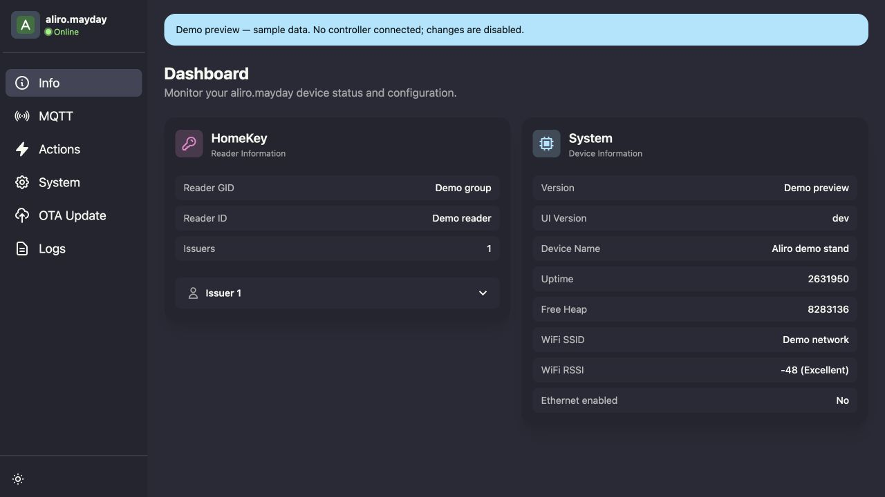
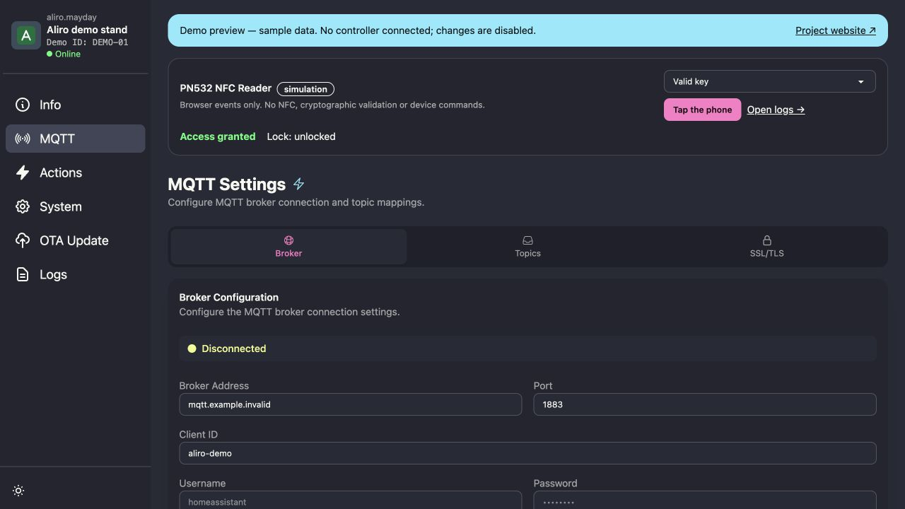
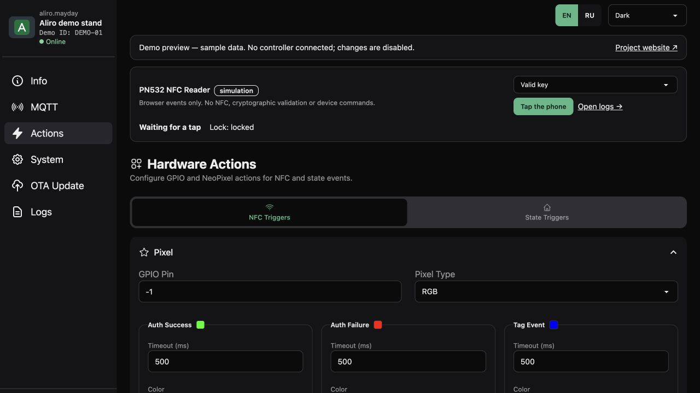
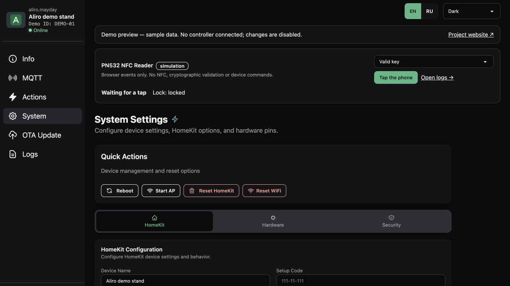
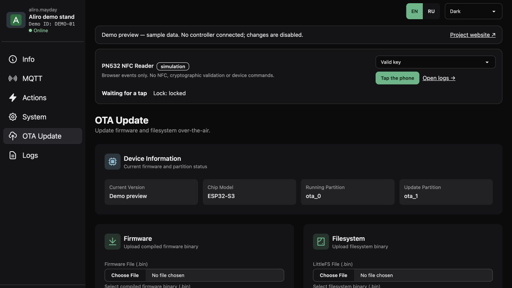
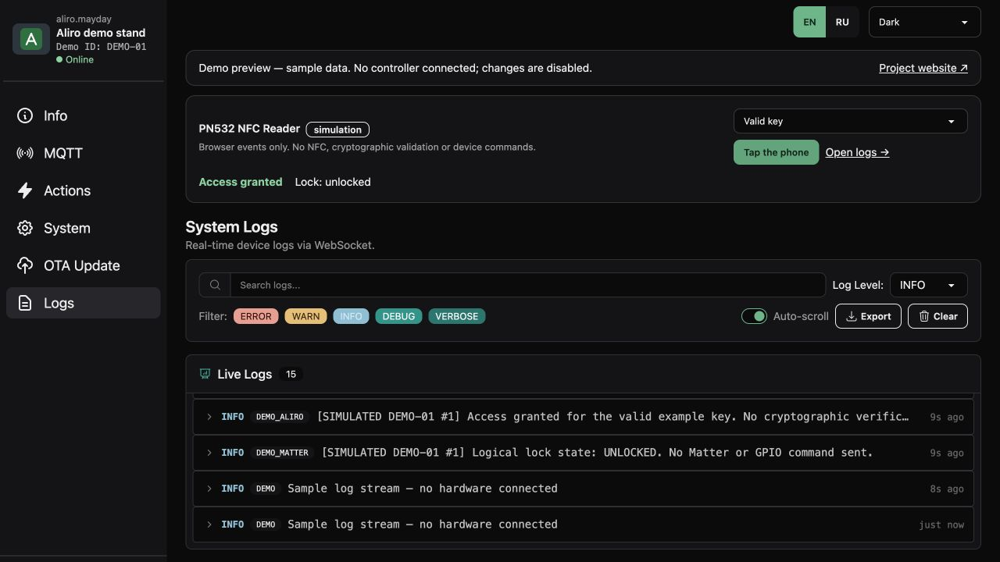

# Веб-панель контроллера: локальный запуск и отладка

[English](controller-ui-debug.md) · [Документация](README.ru.md) · [Фото стенда](demo-stand.ru.md)

Настоящая панель администрирования на Svelte из `aliro-esp32/data` запускается
на компьютере с демонстрационными ответами HTTP/WebSocket. Контроллер,
ESP-IDF, USB, пароль Wi-Fi и сохранённые ключи не нужны. Это просмотр интерфейса;
RF-обмен PN532, APDU, криптографическая проверка, Matter, кошелёк и физический
замок не эмулируются. Результаты примеров доступа явно отмечены как симуляция.

## Живое демо на сайте

[Открыть панель](https://aliro.mayday.software/demo/index.html?lang=ru#/).
Можно переходить по всем шести разделам, открывать вкладки настроек,
менять поля без сохранения и смотреть демонстрационный журнал.
Вся панель поддерживает английский и русский с переключателем EN/RU.
Основной язык — английский; корректный параметр `?lang=en` / `?lang=ru`
имеет приоритет над сохранённым языком панели.

Это отдельная сборка настоящего интерфейса. HTTP-ответы и события устройства
создаются в браузере: запросов к API, WebSocket-соединений и связи с контроллером нет.
Политика `connect-src 'none'` дополнительно запрещает сетевые подключения панели.
Сохранение настроек, сброс устройства, перезагрузка, сертификаты и OTA возвращают отказ деморежима.
После перезагрузки страницы примеры восстанавливаются.

[Лицензионные уведомления демосборки](https://aliro.mayday.software/demo/NOTICES.txt).
Коммерческие условия проекта и лицензии сторонних компонентов не меняются.

На [главной странице](https://aliro.mayday.software/?lang=ru#controller-ui)
это же изолированное демо встроено сразу под фото стенда. Снимки остались
в раскрываемой галерее. Анимация касания и двери связана с той же браузерной симуляцией и журналом
панели. Связи с физическим устройством нет.

## Язык и оформление

Переключатели EN/RU и светлой, тёмной и системной тем общие для контроллера,
локальной отладки и демо на сайте, включая страницу первичной настройки сети.
Выбор применяется в браузере без перезагрузки форм и без команд устройству.
Обычная панель сохраняет настройки под ключами `aliro-ui-language` и
`aliro-ui-theme`; переключение работает и при запрете хранилища браузера.
Старый выбор dracula / autumn сохраняется. Системная тема следует настройке ОС.

Встроенное демо и сайт синхронизируют язык и тему в обе стороны. Принимаются
только сообщения от своего родительского окна/iframe с тем же origin и
допустимыми значениями языка и темы. Переключение сохраняет открытый раздел,
введённые поля, выбранные файлы и состояние виртуального считывателя.
Отдельно открытая панель использует собственные настройки.

Английский текст служит исходным ключом; русский словарь находится в
`aliro-esp32/data/src/lib/i18n/ru.json`. Исходные логи прошивки, ID, SSID,
топики, имена файлов и неизвестные диагностические сообщения сервера сохраняют
свои значения. Известные ошибки интерфейса и сообщения загрузки OTA переводятся
при отображении. Выбор языка и темы не меняет поля API, ключи, сопряжение и
конфигурацию прошивки. Перевод стандарта и сторонних документов сюда не входит.

## Симуляция PN532, журнал и ID контроллера

На главной можно выбрать действующий, отозванный или неизвестный пример ключа
и приложить его к считывателю. В панели есть те же команды. Действующий пример
переключает логическое состояние замка; отказ сохраняет прежнее состояние.
Видимая трасса и раздел Logs показывают одни и те же явно обозначенные
демонстрационные события. Реальных NFC-команд, проверки подписи, Matter, GPIO
или запросов Telegram здесь нет. Сброс симуляции меняет только её временное состояние.

В шапке панели на компьютере и телефоне показаны имя и ID. Длинный ID в мобильной
шапке сокращается; полностью он виден в Dashboard. Обычный интерфейс
читает существующий Reader ID из `/config?type=hkinfo`: это Aliro-идентификатор
считывателя, а не заводской номер ESP32. В обычный Dashboard также добавлены
NFC-диагностика и последние события из существующего WebSocket-журнала.
Эти общие изменения появятся после отдельной сборки и установки ресурсов панели;
публикация кода не прошивает подключённое устройство.

Веб-примеры используют вымышленные ID: по умолчанию `DEMO-01`; второй пример —
`/demo/index.html?controller=DEMO-02&lang=ru#/`. Состояния разных окон изолированы.
Связь с главной страницей проверяет origin, окно-источник, ID и список разрешённых
команд симуляции. CSP по-прежнему запрещает сетевые соединения. В обычную сборку
контроллера кнопки симуляции не включаются. Локальный `bun run debug` поддерживает
эти примеры через свой loopback mock-сервер.

Технический блок описывает путь прототипа ESP32-S3 → PN532/SPI → проверки Aliro →
Matter DoorLock. Это не запись радиоканала и не подтверждение аппаратных испытаний.
Подключение Telegram в публичной Aliro-прошивке не реализовано; демо не подключает бота.

## Быстрый запуск

Установите [Bun](https://bun.sh/docs/installation) **1.3.13** и
[Node.js](https://nodejs.org/en/download) **22.12+** (рекомендуется 24 LTS).
Из корня репозитория:

```sh
cd aliro-esp32/data
bun run debug
```

Откройте **http://127.0.0.1:5173/**. При первом запуске зависимости
устанавливаются по сохранённому `bun.lock`; если пакетов нет в кеше,
потребуется интернет. В панели видна пометка **«Demo preview — sample data»**.
Статус Online относится к локальному демосерверу. Устройство, считыватель,
эмитент, сеть, время работы и журнал содержат примеры.
Прежнее название **HomeKey** сохранено в текущем интерфейсе.

Оба сервера слушают только `127.0.0.1`: демо-API получает свободный порт,
Vite — порт 5173. Скрипт не ищет устройства и не пересылает запросы контроллеру.
Сохранение настроек, сертификатов, перезагрузка, сброс и OTA возвращают ошибку
режима чтения; изменения не сохраняются. Пример GPIO не заменяет
[схему подключения](wiring.ru.md).

## Отладка и остановка

- Правьте `aliro-esp32/data/src/`: Vite автоматически обновляет страницу.
- В инструментах разработчика браузера доступны точки останова, Console,
  запросы Network и сообщения `/ws`. Раздел Logs получает демонстрационные записи.
- Примеры ответов API и запреты записи находятся в
  [controller-ui-fixtures.mjs](../scripts/controller-ui-fixtures.mjs), локальный сервер — в
  [controller-ui-demo.mjs](../scripts/controller-ui-demo.mjs).
  После изменения этого серверного файла перезапустите команду.
- **Ctrl+C** останавливает Vite и демо-API. Состояние контроллера не меняется.
- Если порт 5173 занят: `bun run debug --port 5174`.
  При занятом порте скрипт выдаёт ошибку, а не подменяет адрес другим портом.
- Справка: `bun run debug --help`.
- Требуемые версии `node` и `bun` должны быть доступны через `PATH`.
  Vite работает через Node.js, скрипт запуска и демо-API — через Bun.

Тот же скрипт можно запустить из корня репозитория:

```sh
bun scripts/debug-controller-ui.mjs --port 5173
```

## Проверки и обычная сборка интерфейса

Из `aliro-esp32/data`:

```sh
bun run debug:test
bun run build
```

Тесты проверяют изоляцию браузера, чтение API, запреты записи и команд устройства, чтение и ping
WebSocket, настоящий прокси Vite и остановку серверов. CI выполняет эти проверки
и обычную сборку панели. `bun run build` создаёт привычные сжатые ресурсы
в `aliro-esp32/data/dist/`; по умолчанию деморежим выключен, демосервер
в сборку не входит. `bun run dev` сохраняет прежний прокси на localhost:8000.
Эти команды не прошивают контроллер. Установка прошивки — отдельная операция
из [руководства по прошивке](../aliro-esp32/README.ru.md).

## Проверка вёрстки на разных экранах

Общая панель и демо внутри главной страницы проверяются на **EN и RU**, в
**светлой и тёмной** темах. Матрица включает ширины 320, 360, 390, 430, 768 и
1280 CSS-пикселей в Chromium, а также размеры экрана iPhone в WebKit.
Проверяются все шесть разделов, первичная настройка, раскрытые настройки и записи
журнала, поля сертификатов и длинные имена файлов. Проверки ищут пересечения
текста и горизонтальное переполнение, а не только успешную загрузку страницы.

Из корня репозитория:

```sh
cd aliro-site/frontend
npx playwright install chromium --only-shell
npx playwright install --with-deps webkit
npx playwright test controller-responsive.spec.ts
```

Используются синтетические данные браузера. Эти проверки не обращаются к
контроллеру и не прошивают его.

## Галерея снимков

Шесть настоящих снимков браузера от **16 октября 2026**, сделанных через
локальный демоскрипт. На них показана английская панель в тёмной теме Mayday. В живом демо также
доступны русский язык, светлая и системная темы.
[Переключать снимки на сайте](https://aliro.mayday.software/?lang=ru#controller-ui)
или раскрыть нужный раздел ниже. Нажмите на картинку, чтобы открыть полный размер.

<details open>
<summary>Обзор · Dashboard</summary>

[](../aliro-site/frontend/public/images/controller-dashboard-demo.jpg)

</details>

<details>
<summary>MQTT · MQTT</summary>

[](../aliro-site/frontend/public/images/controller-mqtt-demo.jpg)

</details>

<details>
<summary>Действия · Actions</summary>

[](../aliro-site/frontend/public/images/controller-actions-demo.jpg)

</details>

<details>
<summary>Система · System</summary>

[](../aliro-site/frontend/public/images/controller-system-demo.jpg)

</details>

<details>
<summary>Обновление · OTA Update</summary>

[](../aliro-site/frontend/public/images/controller-ota-demo.jpg)

</details>

<details>
<summary>Журнал · Logs</summary>

[](../aliro-site/frontend/public/images/controller-logs-demo.jpg)

</details>

На снимках нет реального IP контроллера, кода сопряжения, паролей или ключевого
материала. Баннер обозначает демоданные, а Online относится к локальному демо-API.
Это демонстрация веб-панели, а не проверка подключённого устройства.
Файлы прошивки не загружались, обращений к физическому контроллеру не было.

Исходная панель сохраняет [лицензию MIT](../aliro-esp32/data/LICENSE).
Наши скрипт запуска, демосервер и тесты подпадают под
[лицензионные условия репозитория](licensing.ru.md).
Прежние коммерческие условия не меняются.
