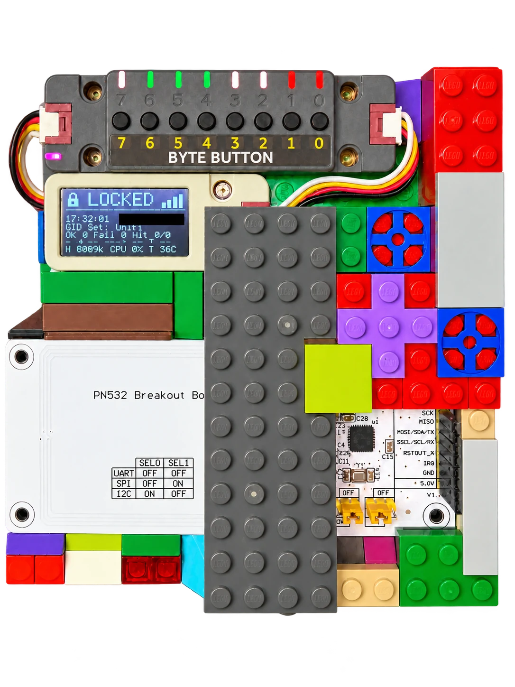
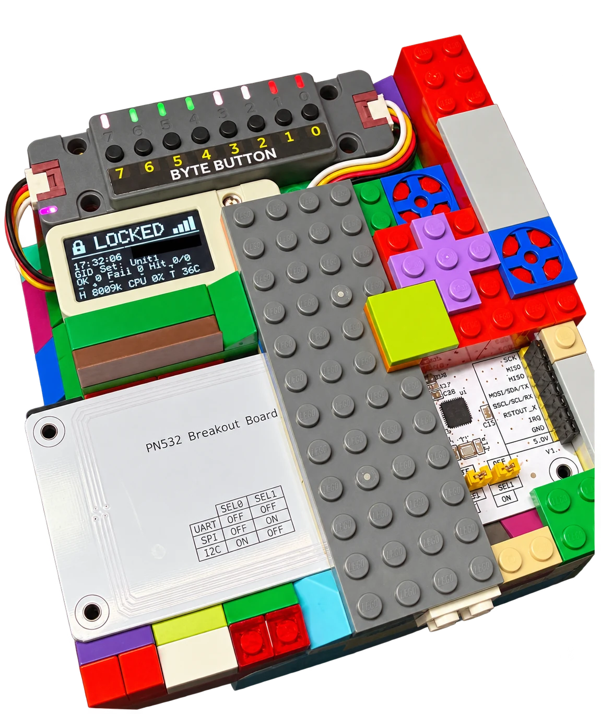

# Aliro demo stand

[Русский](demo-stand.ru.md) · [Documentation](README.md) · [Wiring diagram](wiring.md)

Photos and demo stand: **Mayday / Ilia Arestov**.

## Top view

[Download transparent PNG](../aliro-site/frontend/public/images/demo-stand-top.png)

## Side view

[Download transparent PNG](../aliro-site/frontend/public/images/demo-stand-side.png)

## About these images

These presentation images were edited from the owner's photographs with AI
retouching. The background, unrelated cables and leads outside the right edge of
the LEGO enclosure were removed. The IP address is hidden; other display data
remains visible. The top view also received rotation and perspective correction.

Generative retouching changed some small lettering, display glyphs and physical
details. Use the [source-checked wiring diagram](wiring.md) for electrical
connections, pin labels and module configuration. The photos are not a pinout or
evidence of Samsung Wallet compatibility, a physical lock actuator or Aliro
certification.

The website uses the top view; both presentation views remain available here. WebP copies reduce download size;
PNG files retain transparency for reuse. Original desk photographs, network
addresses, device backups and firmware were not added to the public repository.
