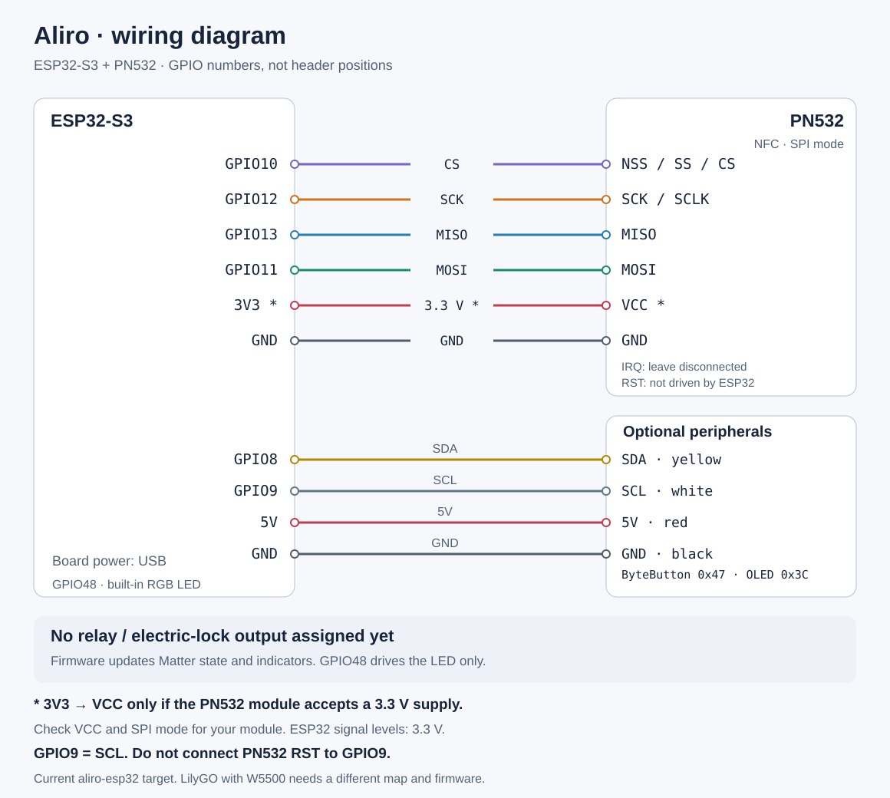

# ESP32-S3 + PN532 wiring

[Русский](wiring.ru.md) · [Documentation](README.md)

This diagram describes the **current `aliro-esp32/` firmware**. `GPIO` labels
are ESP32 signal numbers, not positions on a pin header. Find each contact by
the marking on your board. Connector positions in the drawing are schematic.

## NFC: four SPI signals and power

| ESP32-S3 contact | PN532 contact | Purpose |
| --- | --- | --- |
| `GPIO10` | `NSS` / `SS` / `CS` | NFC module select |
| `GPIO12` | `SCK` / `SCLK` | SPI clock |
| `GPIO13` | `MISO` | Data from PN532 to ESP32 |
| `GPIO11` | `MOSI` | Data from ESP32 to PN532 |
| `GND` | `GND` | Common ground |
| `3V3`, **if the module accepts a 3.3 V supply** | `VCC` | NFC module supply |
| Leave disconnected | `IRQ` | The current driver does not use this pin |
| Do not connect to an ESP32 GPIO | `RST` / `RSTPDN` | Firmware does not drive PN532 reset |

SPI signal levels must be **3.3 V**. `VCC` depends on the actual PN532 breakout:
if its documentation requires 5 V, connect only its supply to a suitable 5 V
source and keep the signals compatible with ESP32. A `5V` marking on a module
does not permit 5 V on ESP32 inputs. If `RSTPDN` requires an external pull-up
to operate, follow the module manufacturer's circuit.

Select **SPI** on the PN532. The V3 boards described in this repository's
earlier material use `SET0=H`, `SET1=L`; check the instructions for any other
revision. Do not infer the mode from the board's colour or shape.

## Display and buttons: shared I²C bus

The current build enables M5Stack Unit ByteButton and Unit OLED 1.3″ SH1107.
Both can share the same four PORT.A lines because their addresses differ.
This wiring applies specifically to those M5Stack modules.

| ESP32-S3 contact | PORT.A on both modules | Supplied cable colour |
| --- | --- | --- |
| `GPIO8` | `SDA` | Yellow |
| `GPIO9` | `SCL` | White |
| Suitable board supply `5V` | `5V` | Red |
| `GND` | `GND` | Black |

ByteButton uses address `0x47`; OLED uses `0x3C`. Supply and cable colours
follow the [ByteButton](https://docs.m5stack.com/en/unit/Unit_ByteButton)
and [OLED](https://docs.m5stack.com/en/unit/Unit_OLED) documentation. Read the
connector markings: the drawing does not specify which side of a plug to view.
For other I²C boards, verify their supply and SDA/SCL pull-up voltage.

**GPIO9 is SCL. Do not connect PN532 reset to it.** The old
[hardware-reference.md](hardware-reference.md) mixed these assignments;
this guide and the current firmware are authoritative for this build.

## Indicators and the physical lock

- `GPIO48` drives the built-in WS2812 RGB indicator on the DevKitC-class target.
  It indicates state; it is not an actuator output. Another board revision may
  place its built-in LED on a different GPIO.
- **Relay output is disabled and unassigned by default.** The native driver
  supports a configurable unlock pulse or logical-state output. Choose a free
  pin explicitly in Actions → Relay control; see [relay setup](access-integrations.md).
  The installed controller has not been updated or tested with a physical relay.
- Power, boot and USB pins are not spare actuator outputs. GPIO14 is not used
  as a PN532 IRQ by this firmware.

## Assemble without changing the working firmware

1. Disconnect power before moving wires. For an existing working bench, first
   compare and record its current connections using the table.
2. Connect common ground, the compatible PN532 supply and the four SPI signals;
   verify SPI mode. An IRQ connection to ESP32 is unnecessary.
3. Connect the shared I²C bus if using the specified M5Stack modules. Do not
   choose PN532 supply voltage from the cable colour.
4. Connect ESP32 over USB. This diagram requires no flashing, NVS reset or
   re-pairing. Check NFC through logs and a real phone tap.

Do not apply this map to **LilyGO T-ETH-Lite-ESP32S3 with W5500**: Ethernet
occupies GPIO9–14. Its frozen `homekey-esp32/` baseline used
`CS=18`, `SCK=15`, `MISO=16`, `MOSI=17`. The current Aliro firmware hard-codes
the first table; Ethernet and that remapping have not been ported into it.

## Sources of the labels

- [app_main.cpp](../aliro-esp32/main/app_main.cpp): `kNfcGpioPins` in
  `[CS, SCK, MISO, MOSI]` order = `[10, 12, 13, 11]`.
- [NfcManager.cpp](../aliro-esp32/main/NfcManager.cpp): SPI transport uses
  `GPIO_NUM_NC` for IRQ; no reset-control GPIO is assigned here.
- [I2cBus.cpp](../aliro-esp32/main/I2cBus.cpp): SDA=8, SCL=9.
- [LockHandlers.cpp](../aliro-esp32/main/LockHandlers.cpp): `kLedGpio=48`;
  logical DoorLock state, indicators and the accepted-state relay hook.
- [sdkconfig.defaults](../aliro-esp32/sdkconfig.defaults): the current build
  profile enables the display and buttons.

The diagram was checked against source. It does not establish the pinout of an
unknown board revision, supply quality, physical lock operation or Samsung Wallet.
