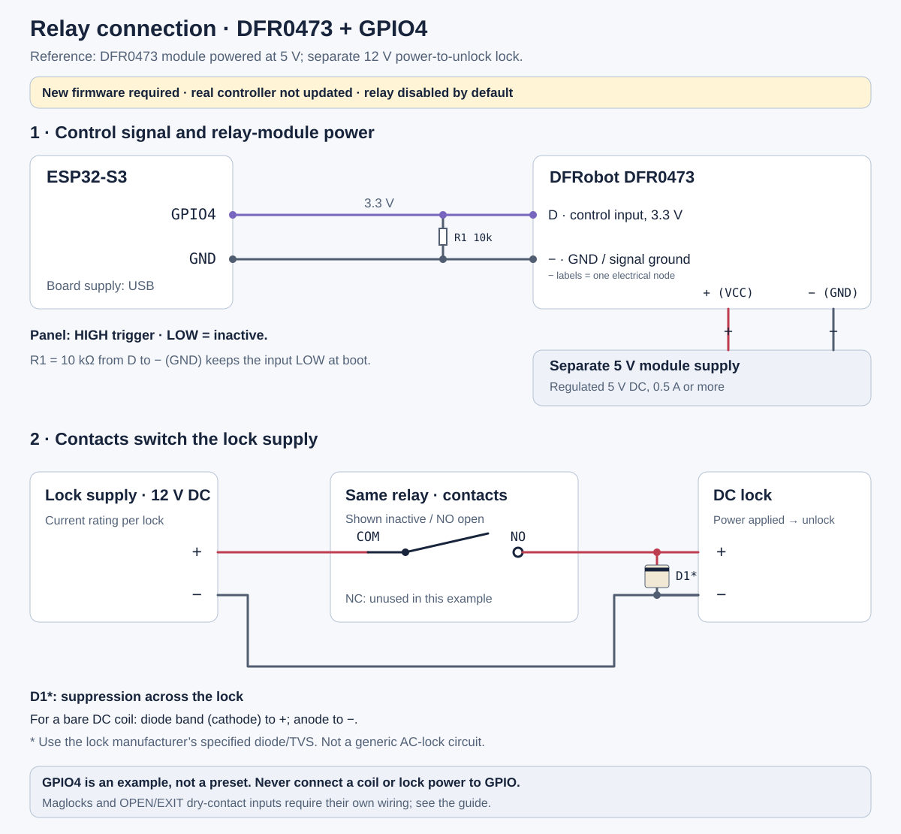

# ESP32-S3 + PN532 wiring

[Русский](wiring.ru.md) · [Documentation](README.md)

[Relay: GPIO4 example](#relay-gpio4-example) · [Telegram setup](access-integrations.md#telegram-setup)

This diagram describes the **current `aliro-esp32/` firmware**. `GPIO` labels
are ESP32 signal numbers, not positions on a pin header. Find each contact by
the marking on your board. Connector positions in the drawing are schematic.

## NFC: four SPI signals and power

| ESP32-S3 contact | PN532 contact | Purpose |
| --- | --- | --- |
| `GPIO10` | `NSS` / `SS` / `CS` | NFC module select |
| `GPIO12` | `SCK` / `SCLK` | SPI clock |
| `GPIO13` | `MISO` | Data from PN532 to ESP32 |
| `GPIO11` | `MOSI` | Data from ESP32 to PN532 |
| `GND` | `GND` | Common ground |
| `3V3`, **if the module accepts a 3.3 V supply** | `VCC` | NFC module supply |
| Leave disconnected | `IRQ` | The current driver does not use this pin |
| Do not connect to an ESP32 GPIO | `RST` / `RSTPDN` | Firmware does not drive PN532 reset |

SPI signal levels must be **3.3 V**. `VCC` depends on the actual PN532 breakout:
if its documentation requires 5 V, connect only its supply to a suitable 5 V
source and keep the signals compatible with ESP32. A `5V` marking on a module
does not permit 5 V on ESP32 inputs. If `RSTPDN` requires an external pull-up
to operate, follow the module manufacturer's circuit.

Select **SPI** on the PN532. The V3 boards described in this repository's
earlier material use `SET0=H`, `SET1=L`; check the instructions for any other
revision. Do not infer the mode from the board's colour or shape.

## Display and buttons: shared I²C bus

The current build enables M5Stack Unit ByteButton and Unit OLED 1.3″ SH1107.
Both can share the same four PORT.A lines because their addresses differ.
This wiring applies specifically to those M5Stack modules.

| ESP32-S3 contact | PORT.A on both modules | Supplied cable colour |
| --- | --- | --- |
| `GPIO8` | `SDA` | Yellow |
| `GPIO9` | `SCL` | White |
| Suitable board supply `5V` | `5V` | Red |
| `GND` | `GND` | Black |

ByteButton uses address `0x47`; OLED uses `0x3C`. Supply and cable colours
follow the [ByteButton](https://docs.m5stack.com/en/unit/Unit_ByteButton)
and [OLED](https://docs.m5stack.com/en/unit/Unit_OLED) documentation. Read the
connector markings: the drawing does not specify which side of a plug to view.
For other I²C boards, verify their supply and SDA/SCL pull-up voltage.

**GPIO9 is SCL. Do not connect PN532 reset to it.** The old
[hardware-reference.md](hardware-reference.md) mixed these assignments;
this guide and the current firmware are authoritative for this build.

## Indicators and the physical lock

- `GPIO48` drives the built-in WS2812 RGB indicator on the DevKitC-class target.
  It indicates state; it is not an actuator output. Another board revision may
  place its built-in LED on a different GPIO.
- **Relay output is disabled and unassigned by default.** The native driver
  supports a configurable unlock pulse or logical-state output. Choose a free
  pin explicitly in Actions → Relay control; see [relay setup](access-integrations.md).
  The installed controller has not been updated or tested with a physical relay.
- Power, boot and USB pins are not spare actuator outputs. GPIO14 is not used
  as a PN532 IRQ by this firmware.

## Relay: GPIO4 example

**This is preparation for a later firmware update. The installed controller
stays unchanged.** There is no preset relay pin: GPIO4 is a selectable example
for the current DevKitC profile, provided nothing else on your board uses it.

### Reference parts to use

Use **one DFRobot Gravity DFR0473 mechanical relay module**, powered at **5 V**,
with its built-in driver and **HIGH** control input. Its control pin is marked
**`D`**, its supply pins **`+`** and **`−`**. The manufacturer documents 3.3 V
logic compatibility; this is our concrete reference, not a requirement to use
a particular brand.

| Part | Reference specification |
| --- | --- |
| Relay | DFRobot DFR0473, one mechanical changeover relay with driver |
| Module supply | Regulated **5 V DC, at least 0.5 A**, separate from the lock |
| R1 | **10 kΩ** from module `D` to module `−` / ESP32 `GND` |
| Demo lock | **12 V DC, power-to-unlock**, supports a 1-second pulse; select a small bench actuator rated at no more than 1 A for this example |
| Lock supply | Sized for that lock and its inrush; e.g. **12 V DC, 2 A** for a compatible ≤1 A bench lock |
| Load suppression | Diode/TVS specified for the chosen DC lock, as shown below |

The module's 5 V input supply is separate from the **3.3 V GPIO signal**. Do not
connect the external 5 V supply to the USB-powered ESP32's 5 V rail in this
example. Only the module's control ground is shared with ESP32. Keep the lock's
12 V circuit on the isolated contacts.

Buy an equivalent only if its documentation confirms **3.3 V input, HIGH trigger,
5 V module supply and voltage-free COM/NO/NC contacts**. A relay case marking
such as `SRD-05VDC-SL-C` alone identifies the relay, not its surrounding module's
input circuit. A visually similar LOW-trigger board is not a drop-in match to
this HIGH setup. Connector positions are schematic; follow the actual labels.
On DFR0473, **`N/A` is an unused terminal**, not COM.

Sources: [DFRobot pinout and electrical specification](https://wiki.dfrobot.com/dfr0473/),
[HIGH/LOW behavior](https://wiki.dfrobot.com/dfr0473/docs/19017),
[manufacturer schematic](https://dfimg.dfrobot.com/wiki/18607/DFR0473_digita-relay-module_schematics_V1.0.pdf).

| From | To | Meaning |
| --- | --- | --- |
| ESP32 `GPIO4` | DFR0473 `D` | Control signal only (3.3 V) |
| ESP32 `GND` | DFR0473 `−` | Signal reference |
| 5 V module supply `+` | DFR0473 `+` | Module power, not GPIO4 |
| 5 V module supply `−` | DFR0473 `−` | Same ground as ESP32 |
| Lock supply `+` | Relay contact `COM` | Start of the switched lock circuit |
| Relay contact `NO` | Lock `+` | Power reaches the lock when the relay is active |
| Lock `−` | Lock supply `−` | Lock-power return |
| Relay contact `NC` | Leave disconnected | Unused for this power-to-unlock example |

The two module `−` / `GND` labels in the drawing are **one electrical node**, not a
promise of two physical pins. The lock circuit is switched through isolated
contacts; its supply negative does not need a connection to ESP32 for that reason.
An optically isolated module may need different ground/jumper wiring: follow
its manufacturer rather than defeating the isolation.

For this HIGH-trigger reference, add **R1 = 10 kΩ from D to − (GND)** to hold
the input LOW while the ESP32 GPIO is high-impedance at boot. For a compatible LOW-trigger module, choose **LOW** in the
panel and use the specified inactive pull-up to **3.3 V**, never a 5 V pull-up on
ESP32 GPIO. A bare relay coil needs a separate transistor/MOSFET driver and coil
suppression; it cannot replace the compatible module shown here.

For a simple inductive DC lock, use the manufacturer's suppression diode/TVS.
Where a flyback diode is specified, connect its **banded end (cathode) to lock +**
and its anode to lock −. The relay coil also needs its own suppression, normally
provided by the driver module. Do not apply this diode example to an AC lock.
Select contact and supply ratings for the lock's switching/inrush current.

| Lock interface | Connection approach |
| --- | --- |
| DC strike that opens when powered | `COM`/`NO` power circuit above; unlock pulse if the lock permits it |
| Controller with a voltage-free `OPEN` / `EXIT` input | Put `COM`/`NO` across the designated input terminals; **do not inject lock-supply voltage into that input** |
| Magnetic or other power-to-lock lock | Needs its own manufacturer circuit and release behavior; this `NO` example is not its wiring recipe |

After the later update, choose **Actions → Relay control → GPIO4**, set the
actual trigger level, and start with **Unlock pulse → 1000 ms** only if the lock
allows that pulse. See [the complete setup steps](access-integrations.md#relay-setup).
Do not move wires while the current USB-powered stand is running.

## Assemble without changing the working firmware

1. Disconnect power before moving wires. For an existing working bench, first
   compare and record its current connections using the table.
2. Connect common ground, the compatible PN532 supply and the four SPI signals;
   verify SPI mode. An IRQ connection to ESP32 is unnecessary.
3. Connect the shared I²C bus if using the specified M5Stack modules. Do not
   choose PN532 supply voltage from the cable colour.
4. Connect ESP32 over USB. This diagram requires no flashing, NVS reset or
   re-pairing. Check NFC through logs and a real phone tap.

Do not apply this map to **LilyGO T-ETH-Lite-ESP32S3 with W5500**: Ethernet
occupies GPIO9–14. Its frozen `homekey-esp32/` baseline used
`CS=18`, `SCK=15`, `MISO=16`, `MOSI=17`. The current Aliro firmware hard-codes
the first table; Ethernet and that remapping have not been ported into it.

## Sources of the labels

- [app_main.cpp](../aliro-esp32/main/app_main.cpp): `kNfcGpioPins` in
  `[CS, SCK, MISO, MOSI]` order = `[10, 12, 13, 11]`.
- [NfcManager.cpp](../aliro-esp32/main/NfcManager.cpp): SPI transport uses
  `GPIO_NUM_NC` for IRQ; no reset-control GPIO is assigned here.
- [I2cBus.cpp](../aliro-esp32/main/I2cBus.cpp): SDA=8, SCL=9.
- [LockHandlers.cpp](../aliro-esp32/main/LockHandlers.cpp): `kLedGpio=48`;
  logical DoorLock state, indicators and the accepted-state relay hook.
- [sdkconfig.defaults](../aliro-esp32/sdkconfig.defaults): the current build
  profile enables the display and buttons.

The diagram was checked against source. It does not establish the pinout of an
unknown board revision, supply quality, physical lock operation or Samsung Wallet.
