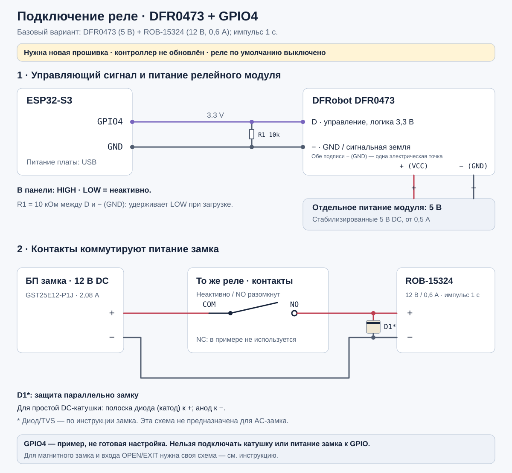

# Подключение ESP32-S3 + PN532

[English](wiring.md) · [Документация](README.ru.md)

[Реле: пример GPIO4](#реле-пример-подключения-к-gpio4) · [Список покупок](#shopping-list) · [Настройка Telegram](access-integrations.ru.md#telegram-setup)

Это схема **текущей прошивки `aliro-esp32/`**. Подписи `GPIO` — номера сигналов
ESP32, а не порядковые номера контактов на гребёнке. Найди контакт по маркировке
на своей плате. Расположение разъёмов на рисунке условное.

## NFC: четыре сигнала SPI и питание

| Контакт ESP32-S3 | Контакт PN532 | Назначение |
| --- | --- | --- |
| `GPIO10` | `NSS` / `SS` / `CS` | Выбор NFC-модуля |
| `GPIO12` | `SCK` / `SCLK` | Тактовый сигнал SPI |
| `GPIO13` | `MISO` | Данные от PN532 к ESP32 |
| `GPIO11` | `MOSI` | Данные от ESP32 к PN532 |
| `GND` | `GND` | Общая земля |
| `3V3`, **если модуль допускает питание 3,3 В** | `VCC` | Питание NFC-модуля |
| Не подключать | `IRQ` | Текущий драйвер не использует этот вывод |
| Не подключать к GPIO | `RST` / `RSTPDN` | Текущая прошивка не управляет сбросом PN532 |

Сигналы SPI должны иметь уровни **3,3 В**. Напряжение `VCC` зависит от конкретной
платы PN532: если её документация требует 5 В, подключай к подходящему источнику
5 В только питание, сохраняя сигналы совместимыми с ESP32. Обозначение `5V`
на модуле не означает допустимость 5 В на входах ESP32. Если `RSTPDN` требует
внешней подтяжки для работы модуля, используй схему его производителя.

Переведи PN532 в **SPI**. Для V3-плат, описанных в прежних материалах этого
репозитория, это `SET0=H`, `SET1=L`; для другой ревизии сверь положения
переключателей с её инструкцией. Не определяй режим по цвету или форме платы.

## Дисплей и кнопки: общая шина I²C

Текущая сборка включает M5Stack Unit ByteButton и Unit OLED 1.3″ SH1107.
Их можно подключить параллельно к одним четырём линиям PORT.A: адреса разные.
Это подключение относится именно к указанным M5Stack-модулям.

| Контакт ESP32-S3 | PORT.A обоих модулей | Цвет штатного кабеля |
| --- | --- | --- |
| `GPIO8` | `SDA` | Жёлтый |
| `GPIO9` | `SCL` | Белый |
| `5V` от подходящего источника питания платы | `5V` | Красный |
| `GND` | `GND` | Чёрный |

ByteButton имеет адрес `0x47`, OLED — `0x3C`. Питание модулей и цвета кабеля
указаны в документации [ByteButton](https://docs.m5stack.com/en/unit/Unit_ByteButton)
и [OLED](https://docs.m5stack.com/en/unit/Unit_OLED). Порядок контактов определяй
по подписям на разъёме: рисунок не задаёт, с какой стороны смотреть на штекер.
Для других I²C-плат проверь их питание и напряжение подтяжек SDA/SCL.

**GPIO9 занят SCL. Не подключай к нему сброс PN532.** В старом
[hardware-reference.md](hardware-reference.md) эти линии были смешаны;
актуальное назначение задаёт эта инструкция и код текущей прошивки.

## Индикация и физический замок

- `GPIO48` используется для встроенного адресного RGB-светодиода WS2812
  DevKitC-класса. Он показывает состояние; это не выход управления замком.
  У другой ревизии платы встроенный LED может находиться на другом GPIO.
- **Реле по умолчанию выключено, пин не назначен.** Нативный драйвер
  поддерживает импульс открытия и следование логическому состоянию. Выберите
  свободный пин в Действия → Управление реле; см. [настройку реле](access-integrations.ru.md).
  Установленный контроллер не обновлялся и с физическим реле не проверен.
- GPIO питания, входы загрузки и USB не являются свободными выходами замка.
  GPIO14 в этой прошивке не используется как IRQ PN532.

## Реле: пример подключения к GPIO4

**Это подготовка к будущему обновлению. Установленный контроллер не меняем.**
Готового пина реле нет: GPIO4 — выбираемый пример для текущей DevKitC-платы,
если он не занят другим устройством на вашей конкретной плате.

### Список покупок для базовой сборки

Берём **один DFRobot Gravity DFR0473**: обычный механический релейный модуль
с готовым драйвером, питанием **5 В** и включением уровнем **HIGH**. На нём
управляющий вход подписан **`D`**, питание — **`+`** и **`−`**. Производитель
подтверждает совместимость управления с 3,3 В. Это конкретный образец для
схемы; использовать только этот бренд не обязательно.

Список рассчитан на **стендовый замок 12 В DC с открытием от подачи питания,
паспортным током не более 1 А и допустимым импульсом 1 с**. Сам замок здесь
не выбран; перед подключением сверьте его питание и пусковой ток.

| Что купить | Количество | Назначение / параметры |
| --- | --- | --- |
| [Релейный модуль DFRobot DFR0473](https://www.dfrobot.com/product-1572.html) | 1 шт. | Механическое переключающее реле с драйвером; управление HIGH от 3,3 В |
| [БП Mean Well GST18E05-P1J](https://www.digikey.com/en/products/detail/mean-well-usa-inc/GST18E05-P1J/7703622) | 1 шт. | **5 В DC, 3 А** для модуля реле; для базовой схемы достаточно от 0,5 А |
| [БП Mean Well GST25E12-P1J](https://www.digikey.com/en/products/detail/mean-well-usa-inc/GST25E12-P1J/7703666) | 1 шт. | **12 В DC, 2,08 А** для подходящего стендового замка с учётом его пускового тока |
| [Резистор 10 кОм, 0,25 Вт](https://www.adafruit.com/product/2784) | Нужен 1 шт.; продаётся пачкой | R1 между `D` модуля и `−` / `GND` ESP32 |
| Провода Dupont [мама–мама](https://www.adafruit.com/product/266) и [мама–папа](https://www.adafruit.com/product/5018) | По небольшому набору | Короткие сигнальные соединения; не цепь питания замка |
| [Многожильный медный провод 20 AWG ≈ 0,5 мм²](https://www.pololu.com/product/2652/) | Всего около 2–3 м; желательно красный и чёрный | Короткие соединения питания замка на стенде; катушка по ссылке больше необходимого |
| [Гнездо DC 5,5×2,1 мм → винтовые клеммы](https://www.adafruit.com/product/368) | 2 шт. | Подключить оба БП без обрезания штекеров |
| [Защитный диод 1N4001](https://www.adafruit.com/product/755) | Нужен 1 шт.; продаётся пачкой | Для простой DC-катушки без встроенной защиты, если допускается инструкцией замка; иначе используйте указанный производителем диод/TVS |

У двух выбранных БП **евровилки** и выходные штекеры 5,5×2,1 мм с плюсом
в центре. Ссылки — на конкретные образцы: аналоги можно найти у местных
продавцов по модели и параметрам. Цены и наличие могут меняться. В стандартном
комплекте DFR0473 есть кабель Gravity; проверьте комплектацию продавца.

Питание модуля 5 В и **управляющий сигнал GPIO 3,3 В** — разные цепи. В этом
примере внешний источник 5 В не соединяем с шиной 5 В ESP32, уже запитанного
по USB. С ESP32 объединяется только сигнальная земля модуля. Цепь замка 12 В
остаётся на изолированных контактах.

Аналог подходит, если в его документации указаны **вход 3,3 В, включение HIGH,
питание модуля 5 В и сухие контакты COM/NO/NC**. Одной надписи на корпусе реле,
например `SRD-05VDC-SL-C`, недостаточно: она не описывает входную схему модуля.
Внешне похожая плата с включением LOW не соответствует этой настройке HIGH.
Положение контактов на схеме условное; смотрите реальные подписи.
У DFR0473 **`N/A` — пустая клемма**, а не COM.

Источники: [распиновка и параметры DFRobot](https://wiki.dfrobot.com/dfr0473/),
[поведение HIGH/LOW](https://wiki.dfrobot.com/dfr0473/docs/19017),
[схема производителя](https://dfimg.dfrobot.com/wiki/18607/DFR0473_digita-relay-module_schematics_V1.0.pdf).

| Откуда | Куда | Назначение |
| --- | --- | --- |
| ESP32 `GPIO4` | `D` модуля DFR0473 | Только управляющий сигнал 3,3 В |
| ESP32 `GND` | `−` модуля DFR0473 | Общая сигнальная земля |
| `+` источника 5 В модуля | `+` модуля DFR0473 | Питание модуля, не от GPIO4 |
| `−` источника 5 В модуля | `−` модуля DFR0473 | Общая земля с ESP32 |
| `+` блока питания замка | Контакт реле `COM` | Начало коммутируемой цепи замка |
| Контакт реле `NO` | `+` замка | Питание поступает при срабатывании реле |
| `−` замка | `−` блока питания замка | Обратный провод питания замка |
| Контакт реле `NC` | Не подключать | В примере с открытием от питания не используется |

Две подписи `−` / `GND` у модуля на рисунке — **одна электрическая точка**, а не
обещание двух физических клемм. Питание замка коммутируется изолированными
контактами; ради этого соединять его минус с ESP32 не требуется.
У оптоизолированного модуля земля и перемычки могут подключаться иначе:
используйте схему производителя, сохраняя предусмотренную развязку.

В этом примере HIGH включает реле, а LOW выключает. Добавьте **R1 = 10 кОм между D и − (GND)**: он удерживает LOW, пока GPIO
при загрузке находится в высокоимпедансном состоянии. Если совместимый модуль
включается уровнем LOW, выберите **LOW** в панели и используйте его штатную
подтяжку к неактивным **3,3 В** — не к 5 В на GPIO ESP32. Голая катушка реле
требует отдельного транзисторного/MOSFET-драйвера и защиты катушки; напрямую
вместо показанного совместимого модуля её подключать нельзя.

Для простой индуктивной DC-катушки замка используйте диод/TVS по инструкции
замка. Если нужен обратный диод, его **конец с полоской (катод) — к плюсу
замка**, анод — к минусу. Катушке самого реле нужна отдельная защита, обычно
встроенная в модуль. Этот пример с диодом не подходит для AC-замка.
Номинал контактов и питания выбирается с учётом пускового тока замка.

| Какой вход у замка | Как подключать |
| --- | --- |
| DC-защёлка, открывается от подачи питания | Цепь `COM`/`NO` выше; импульс открытия, если разрешён для этого замка |
| Контроллер с входом «сухой контакт» `OPEN` / `EXIT` | `COM`/`NO` замыкают указанные входные клеммы; **не подавайте туда напряжение блока питания замка** |
| Магнитный или другой замок, удерживающий дверь при наличии питания | Нужна его собственная схема и логика отпускания; этот пример с `NO` для него не является инструкцией |

После будущего обновления выберите **Действия → Управление реле → GPIO4**,
укажите фактический активный уровень и начните с **Импульс открытия → 1000 мс**,
только если такой импульс разрешён замком. См. [полную настройку](access-integrations.ru.md#relay-setup).
Не переставляйте провода работающего стенда, пока он запитан по USB.

## Как собрать без изменения работающей прошивки

1. Отключи питание перед перестановкой проводов. Если текущий стенд уже работает,
   сначала сопоставь существующие провода с таблицей и запиши подключения.
2. Соедини общую землю, питание совместимого PN532 и четыре линии SPI;
   проверь режим SPI. Подключение IRQ к ESP32 не требуется.
3. При использовании указанных M5Stack-модулей подключи общую I²C-шину.
   Не соединяй питание PN532 с линией 5 В на основании цвета кабеля.
4. Подключи ESP32 по USB. Эта схема не требует прошивки, сброса NVS или
   повторного сопряжения. Работу NFC проверяй журналом и прикладыванием телефона.

Не применяй эту карту к **LilyGO T-ETH-Lite-ESP32S3 с W5500**: Ethernet занимает
GPIO9–14. В замороженном `homekey-esp32/` для неё использовали
`CS=18`, `SCK=15`, `MISO=16`, `MOSI=17`. Текущий Aliro firmware жёстко задаёт
первую таблицу; поддержка Ethernet и такого переназначения в него не перенесена.

## Откуда взяты подписи

- [app_main.cpp](../aliro-esp32/main/app_main.cpp): `kNfcGpioPins` в порядке
  `[CS, SCK, MISO, MOSI]` = `[10, 12, 13, 11]`.
- [NfcManager.cpp](../aliro-esp32/main/NfcManager.cpp): SPI transport получает
  `GPIO_NUM_NC` вместо IRQ; управляющий GPIO сброса здесь не задан.
- [I2cBus.cpp](../aliro-esp32/main/I2cBus.cpp): SDA=8, SCL=9.
- [LockHandlers.cpp](../aliro-esp32/main/LockHandlers.cpp): `kLedGpio=48`;
  логическое состояние DoorLock, LED и вызов драйвера после принятого изменения.
- [sdkconfig.defaults](../aliro-esp32/sdkconfig.defaults): дисплей и кнопки
  включены в текущем профиле сборки.

Схема сверена с исходниками. Она не подтверждает распиновку неизвестной ревизии
платы, качество питания, физическую работу замка или Samsung Wallet.
