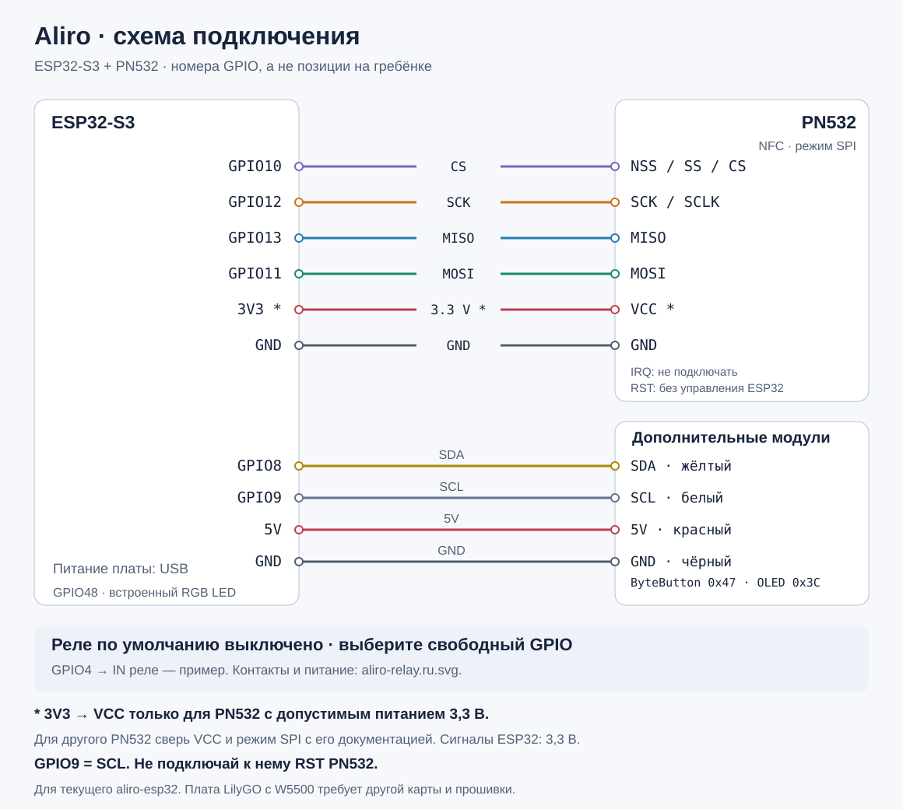

# Подключение ESP32-S3 + PN532

[English](wiring.md) · [Документация](README.ru.md)

Это схема **текущей прошивки `aliro-esp32/`**. Подписи `GPIO` — номера сигналов
ESP32, а не порядковые номера контактов на гребёнке. Найди контакт по маркировке
на своей плате. Расположение разъёмов на рисунке условное.

## NFC: четыре сигнала SPI и питание

| Контакт ESP32-S3 | Контакт PN532 | Назначение |
| --- | --- | --- |
| `GPIO10` | `NSS` / `SS` / `CS` | Выбор NFC-модуля |
| `GPIO12` | `SCK` / `SCLK` | Тактовый сигнал SPI |
| `GPIO13` | `MISO` | Данные от PN532 к ESP32 |
| `GPIO11` | `MOSI` | Данные от ESP32 к PN532 |
| `GND` | `GND` | Общая земля |
| `3V3`, **если модуль допускает питание 3,3 В** | `VCC` | Питание NFC-модуля |
| Не подключать | `IRQ` | Текущий драйвер не использует этот вывод |
| Не подключать к GPIO | `RST` / `RSTPDN` | Текущая прошивка не управляет сбросом PN532 |

Сигналы SPI должны иметь уровни **3,3 В**. Напряжение `VCC` зависит от конкретной
платы PN532: если её документация требует 5 В, подключай к подходящему источнику
5 В только питание, сохраняя сигналы совместимыми с ESP32. Обозначение `5V`
на модуле не означает допустимость 5 В на входах ESP32. Если `RSTPDN` требует
внешней подтяжки для работы модуля, используй схему его производителя.

Переведи PN532 в **SPI**. Для V3-плат, описанных в прежних материалах этого
репозитория, это `SET0=H`, `SET1=L`; для другой ревизии сверь положения
переключателей с её инструкцией. Не определяй режим по цвету или форме платы.

## Дисплей и кнопки: общая шина I²C

Текущая сборка включает M5Stack Unit ByteButton и Unit OLED 1.3″ SH1107.
Их можно подключить параллельно к одним четырём линиям PORT.A: адреса разные.
Это подключение относится именно к указанным M5Stack-модулям.

| Контакт ESP32-S3 | PORT.A обоих модулей | Цвет штатного кабеля |
| --- | --- | --- |
| `GPIO8` | `SDA` | Жёлтый |
| `GPIO9` | `SCL` | Белый |
| `5V` от подходящего источника питания платы | `5V` | Красный |
| `GND` | `GND` | Чёрный |

ByteButton имеет адрес `0x47`, OLED — `0x3C`. Питание модулей и цвета кабеля
указаны в документации [ByteButton](https://docs.m5stack.com/en/unit/Unit_ByteButton)
и [OLED](https://docs.m5stack.com/en/unit/Unit_OLED). Порядок контактов определяй
по подписям на разъёме: рисунок не задаёт, с какой стороны смотреть на штекер.
Для других I²C-плат проверь их питание и напряжение подтяжек SDA/SCL.

**GPIO9 занят SCL. Не подключай к нему сброс PN532.** В старом
[hardware-reference.md](hardware-reference.md) эти линии были смешаны;
актуальное назначение задаёт эта инструкция и код текущей прошивки.

## Индикация и физический замок

- `GPIO48` используется для встроенного адресного RGB-светодиода WS2812
  DevKitC-класса. Он показывает состояние; это не выход управления замком.
  У другой ревизии платы встроенный LED может находиться на другом GPIO.
- **Пин реле/электрозамка пока не назначен.** Обработчики меняют состояние
  Matter DoorLock и индикацию; физический драйвер замка не реализован.
  Пока не подключай `IN` реле к произвольному GPIO из этой схемы.
- GPIO питания, входы загрузки и USB не являются свободными выходами замка.
  GPIO14 в этой прошивке не используется как IRQ PN532.

## Как собрать без изменения работающей прошивки

1. Отключи питание перед перестановкой проводов. Если текущий стенд уже работает,
   сначала сопоставь существующие провода с таблицей и запиши подключения.
2. Соедини общую землю, питание совместимого PN532 и четыре линии SPI;
   проверь режим SPI. Подключение IRQ к ESP32 не требуется.
3. При использовании указанных M5Stack-модулей подключи общую I²C-шину.
   Не соединяй питание PN532 с линией 5 В на основании цвета кабеля.
4. Подключи ESP32 по USB. Эта схема не требует прошивки, сброса NVS или
   повторного сопряжения. Работу NFC проверяй журналом и прикладыванием телефона.

Не применяй эту карту к **LilyGO T-ETH-Lite-ESP32S3 с W5500**: Ethernet занимает
GPIO9–14. В замороженном `homekey-esp32/` для неё использовали
`CS=18`, `SCK=15`, `MISO=16`, `MOSI=17`. Текущий Aliro firmware жёстко задаёт
первую таблицу; поддержка Ethernet и такого переназначения в него не перенесена.

## Откуда взяты подписи

- [app_main.cpp](../aliro-esp32/main/app_main.cpp): `kNfcGpioPins` в порядке
  `[CS, SCK, MISO, MOSI]` = `[10, 12, 13, 11]`.
- [NfcManager.cpp](../aliro-esp32/main/NfcManager.cpp): SPI transport получает
  `GPIO_NUM_NC` вместо IRQ; управляющий GPIO сброса здесь не задан.
- [I2cBus.cpp](../aliro-esp32/main/I2cBus.cpp): SDA=8, SCL=9.
- [LockHandlers.cpp](../aliro-esp32/main/LockHandlers.cpp): `kLedGpio=48`;
  логическое состояние DoorLock и LED без выхода реле.
- [sdkconfig.defaults](../aliro-esp32/sdkconfig.defaults): дисплей и кнопки
  включены в текущем профиле сборки.

Схема сверена с исходниками. Она не подтверждает распиновку неизвестной ревизии
платы, качество питания, физическую работу замка или Samsung Wallet.
